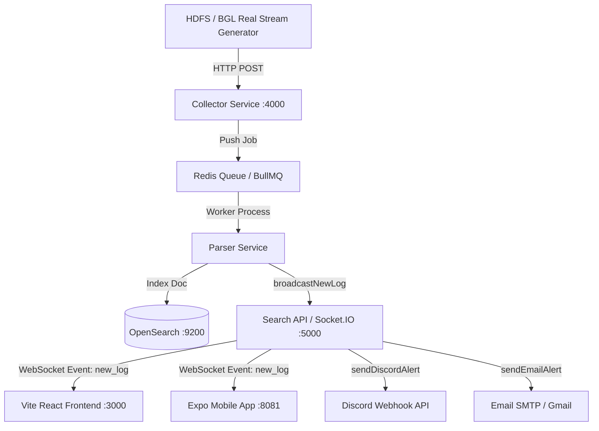

# Kiến Trúc Hệ Thống Log Analytics & Anomaly Detection Dashboard

## 1. Luồng Dữ Liệu Realtime (Log Streaming Architecture)



## 2. Các Thành Phần Chính (Services & Ports)

| Service | Công Nghệ | Port | Chức Năng |
| :--- | :--- | :--- | :--- |
| **Collector Service** | Express.js | `4000` | Tiếp nhận log từ client/streamer qua HTTP API |
| **Search API & WebSocket** | Express + Socket.IO | `5000` | Cung cấp RESTful Search API, phát sóng log realtime, quản lý cấu hình & phát cảnh báo đa kênh |
| **Parser Service** | Worker Thread / BullMQ | N/A | Phân tích cấu trúc log (Drain Algorithm), gắn Anomaly Score |
| **OpenSearch Storage** | OpenSearch Cluster | `9200` | Lưu trữ chỉ mục log và hỗ trợ tìm kiếm toàn văn |
| **Frontend UI (Web)** | React + Vite + CSS | `3000` | Giao diện theo dõi log, biểu đồ trực quan, bộ lọc đa năng, xuất báo cáo CSV/XLSX & Modal soi log chi tiết |
| **Mobile App (Expo)** | React Native + Expo | `8081` | Ứng dụng di động đa nền tảng (iOS/Android) 5 Tabs chuẩn Elevated Dock, Role-based Navigation, Realtime Socket.IO & Trợ lý AI nổi toàn cục |
| **Multi-Channel Alerts** | Discord Webhook + Nodemailer | HTTPS / SMTP | Gửi tin nhắn tức thì sang Discord & gửi email báo cáo sự cố qua Gmail hoàn toàn miễn phí |
| **ML API (Python)** | FastAPI + scikit-learn | `8000` | Serve Isolation Forest & Logistic Regression real-time qua `POST /predict` |
| **AI Assistant Service** | Groq + Gemini REST API | N/A (tích hợp trong Search API :5000) | Trợ lý AI phân tích log, giải thích nguyên nhân bất thường, hỏi đáp tự do về giám sát hệ thống. Groq (primary) + Gemini (fallback) |
| **Pipeline Health Service** | BullMQ API + Rolling Metrics | N/A (tích hợp trong Search API :5000) | Giám sát trạng thái hàng đợi BullMQ (waiting/active/failed), tính thông lượng throughput (log/s) & độ trễ pipeline |
| **Authentication & RBAC** | JWT + bcryptjs | N/A (tích hợp trong Search API :5000) | Quản lý đăng nhập và phân quyền truy cập: Admin (toàn quyền) & Viewer (chỉ xem, khóa lưu cấu hình) |
| **Incident Lifecycle Service** | In-memory + Persistent JSON Store | N/A (tích hợp trong Search API :5000) | Quản lý vòng đời sự cố (NEW/ACK/RESOLVED), ghi chú khắc phục, deduplication 60s & chế độ bảo trì (Silence) |
| **Cron & Retention Service** | node-cron + OpenSearch API | N/A (tích hợp trong Search API :5000) | Lập lịch tự động gửi Daily Digest lúc 08:00 (Discord + Email) & dọn dẹp log cũ quá hạn lúc 00:00 (Retention Policy) |

## 3. ML Training Pipeline (Offline — chạy 1 lần)

```
[HDFS_2k.log + anomaly_label.csv]     [BGL_2k.log]
       │ hdfsLoader.js                        │ bglLoader.js
       ▼ (block_id sequences)                 ▼ (time windows 60s)
[generate_vectors.js] ──────────────► [generate_vectors.js]
       │ Drain Vectorizer                     │ Drain Vectorizer
       ▼                                      ▼
[vectors_hdfs.json]                   [vectors_bgl.json]
       │                                      │
       └──────────────────┬───────────────────┘
                          ▼
             [train_and_evaluate.py]
                  │  Isolation Forest (unsupervised)
                  │  Logistic Regression (supervised)
                  ▼
        [*.pkl models]   [results_hdfs.json / results_bgl.json]
             (Precision / Recall / F1)
```

