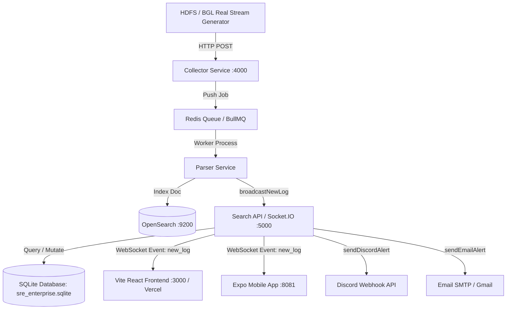

# Kiến Trúc Hệ Thống Log Analytics & Anomaly Detection Dashboard

## 1. Luồng Dữ Liệu Realtime (Log Streaming Architecture)



## 2. Các Thành Phần Chính (Services & Ports)

| Service | Công Nghệ | Port | Chức Năng |
| :--- | :--- | :--- | :--- |
| **Collector Service** | Express.js | `4000` | Tiếp nhận log từ client/streamer qua HTTP API; tích hợp cơ chế Ingestion Fallback ghi trực tiếp SQLite và phát sóng Socket.IO khi collector offline |
| **Search API & WebSocket** | Express + Socket.IO | `5000` | Cung cấp RESTful Search API, phát sóng log realtime, quản lý cấu hình & phát cảnh báo đa kênh |
| **Parser Service** | Worker Thread / BullMQ | N/A | Bóc tách cấu trúc log (Drain Mining trên 100% dữ liệu thật HDFS/BGL/OpenSearch, hỗ trợ Infinite Scroll 10 bản ghi), gắn Anomaly Score |
| **OpenSearch Storage** | OpenSearch Cluster | `9200` | Lưu trữ chỉ mục log và hỗ trợ tìm kiếm toàn văn |
| **Frontend UI (Web)** | React + Vite + CSS | `3000` | Giao diện theo dõi log, biểu đồ trực quan, CustomSelect Dark Mode, Ma trận Heatmap 24h & Modal chi tiết lỗi, SRE Messenger, chú thích 6 Tab, Lịch sử Cron & Audit |
| **Mobile App (Expo)** | React Native + Expo | `8081` | Ứng dụng di động đa nền tảng (iOS/Android) 5 Tabs chuẩn Elevated Dock, Role-based Navigation, Realtime Socket.IO & Trợ lý AI nổi toàn cục |
| **Multi-Channel Alerts** | Discord Webhook + Nodemailer | HTTPS / SMTP | Gửi tin nhắn tức thì sang Discord & gửi email báo cáo sự cố qua Gmail hoàn toàn miễn phí |
| **ML API (Python)** | FastAPI + scikit-learn | `8000` | Serve Isolation Forest & Logistic Regression (`.pkl` + `drain_vocab.json`) real-time qua `POST /predict` |
| **AI Assistant Service** | Groq + Gemini REST API | N/A (tích hợp trong Search API :5000) | Trợ lý AI phân tích log, giải thích nguyên nhân bất thường, hỏi đáp tự do về giám sát hệ thống. Groq (primary) + Gemini (fallback & Multimodal Image Vision). Hiệu ứng Typewriter render mượt mà. |
| **SRE Internal Messenger** | Socket.IO + SQLite (`tin_nhan_noi_bo`) | N/A (tích hợp trong Search API :5000) | Kênh trao đổi trực tiếp realtime (xác thực JWT) giữa Quản Trị Viên (Admin) và Giám Sát Viên (Viewer), hỗ trợ đính kèm thẻ log sự cố và xem chi tiết tức thì. |
| **Pipeline Health Service** | BullMQ API + Rolling Metrics | N/A (tích hợp trong Search API :5000) | Giám sát trạng thái hàng đợi BullMQ (waiting/active/failed), tính thông lượng throughput (log/s) & độ trễ pipeline |
| **Authentication & RBAC** | JWT + bcryptjs | N/A (tích hợp trong Search API :5000) | Quản lý đăng nhập và phân quyền RBAC chặt chẽ ở cả API (`requireAdmin` / `authenticateToken`) và Client: Admin (toàn quyền) & Viewer (chỉ xem & thêm note điều tra) |
| **Incident Lifecycle Service** | SQLite Database (`better-sqlite3`) | N/A (tích hợp trong Search API :5000) | Quản lý vòng đời sự cố SRE chuẩn hóa (NEW ➔ ACK ➔ RESOLVED), bắt buộc `root_cause` & `action_taken` khi đóng sự cố, phân loại mức độ ưu tiên (P1/P2/P3), deduplication 60s & chế độ bảo trì (Silence) |
| **Enterprise SQLite Database** | SQLite 3 (WAL mode) | File `BE/data/sre_enterprise.sqlite` | Lưu trữ bền vững 9 bảng dữ liệu chuẩn SRE: người dùng RBAC, vòng đời sự cố, ghi chú điều tra, cấu hình hệ thống, lịch bảo trì, nhật ký kiểm toán (Audit Trail), lịch sử cron, tin nhắn nội bộ SRE và bảng `log_du_phong` (Ingestion Fallback) |
| **Cron & Retention Service** | node-cron + OpenSearch + SQLite | N/A (tích hợp trong Search API :5000) | Lập lịch tự động gửi Daily Digest lúc 08:00 (Discord + Email), dọn dẹp log cũ quá hạn lúc 00:00 (Retention Policy) và ghi lịch sử chạy vào bảng `lich_su_cron` |

## 3. ML Training Pipeline (Offline — chạy 1 lần)

```
[HDFS_2k.log + anomaly_label.csv]     [BGL_2k.log]
       │ hdfsLoader.js                        │ bglLoader.js
       ▼ (block_id sequences)                 ▼ (time windows 60s)
[generate_vectors.js] ──────────────► [generate_vectors.js]
       │ Drain Vectorizer                     │ Drain Vectorizer
       ▼                                      ▼
[vectors_hdfs.json]                   [vectors_bgl.json]
       │                                      │
       └──────────────────┬───────────────────┘
                          ▼
             [train_and_evaluate.py]
                  │  Isolation Forest (unsupervised)
                  │  Logistic Regression (supervised)
                  ▼
        [*.pkl models]   [results_hdfs.json / results_bgl.json]
             (Precision / Recall / F1)
```

## 4. Bộ Công Cụ Benchmark & Đánh Giá Định Lượng (Evaluation Suite)

Hệ thống tích hợp sẵn kịch bản kiểm thử toàn diện `npm run benchmark:full` (`BE/benchmark/full_evaluation.js`):
- **Hiệu năng Pipeline**: Đo thông lượng (log/s) và phân vị độ trễ (Avg, p50, p90, p99) qua `perf_hooks`.
- **Đánh giá độ chính xác 4 mô hình**: Đo Precision, Recall, F1-Score, Confusion Matrix đối chiếu giữa Rule-based, Z-Score, Isolation Forest và Logistic Regression trên 2 tập dữ liệu chuẩn quốc tế HDFS và BGL (Loghub).
- **Xuất báo cáo khoa học**: Lưu kết quả tự động ra `BE/benchmark/REPORT_BENCHMARK_EVALUATION.md` và `BE/benchmark/evaluation_summary.json` phục vụ trực tiếp cho báo cáo và slide bảo vệ đồ án tốt nghiệp.

