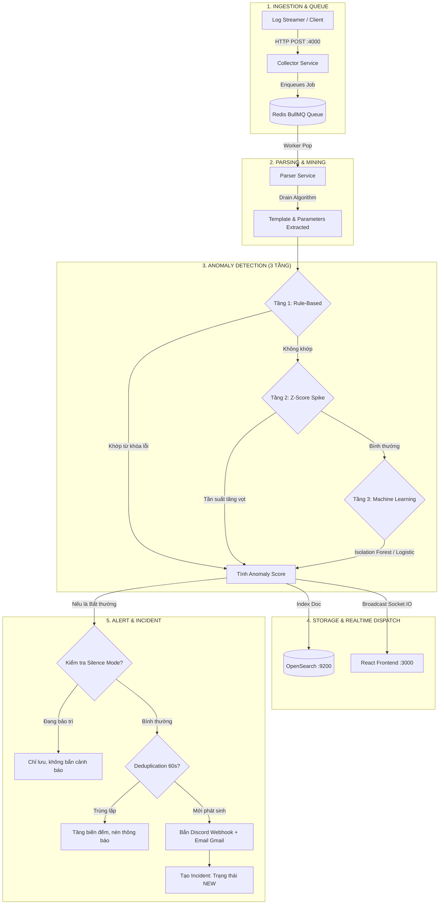

# TÀI LIỆU ĐẶC TẢ NGHIỆP VỤ HỆ THỐNG
## HỆ THỐNG PHÂN TÍCH LOG TẬP TRUNG VÀ PHÁT HIỆN BẤT THƯỜNG (LOGPULSE ANALYTICS)

> **Dự án Đồ án tốt nghiệp Công nghệ Thông tin**  
> **Đề tài**: Nghiên cứu và xây dựng hệ thống phân tích log tập trung và phát hiện bất thường  
> **Mã dự án**: `DATN-2026-LOGPULSE`  
> **Cập nhật lần cuối**: Tháng 10/2026

---

## MỤC LỤC
1. [TỔNG QUAN & BỐI CẢNH NGHIỆP VỤ](#1-tổng-quan--bối-cảnh-nghiệp-vụ)
2. [ĐỐI TƯỢNG NGƯỜI DÙNG & VAI TRÒ (ACTORS & PERSONAS)](#2-đối-tượng-người-dùng--vai-trò-actors--personas)
3. [MA TRẬN PHÂN QUYỀN TRUY CẬP (RBAC MATRIX)](#3-ma-trận-phân-quyền-truy-cập-rbac-matrix)
4. [CÁC QUY TRÌNH NGHIỆP VỤ CỐT LÕI (CORE BUSINESS WORKFLOWS)](#4-các-quy-trình-nghiệp-vụ-cốt-lõi-core-business-workflows)
   - [Quy trình 1: Thu thập & Đệm log thông lượng cao](#quy-trình-1-thu-thập--đệm-log-thông-lượng-cao)
   - [Quy trình 2: Bóc tách cấu trúc log tự động (Drain Algorithm)](#quy-trình-2-bóc-tách-cấu-trúc-log-tự-động-drain-algorithm)
   - [Quy trình 3: Phân tích & Phát hiện bất thường 3 tầng](#quy-trình-3-phân-tích--phát-hiện-bất-thường-3-tầng)
   - [Quy trình 4: Cảnh báo đa kênh thông minh & Chống bão thông báo](#quy-trình-4-cảnh-báo-đa-kênh-thông-minh--chống-bão-thông-báo)
   - [Quy trình 5: Quản lý vòng đời sự cố (Incident Lifecycle)](#quy-trình-5-quản-lý-vòng-đời-sự-cố-incident-lifecycle)
   - [Quy trình 6: Trợ lý AI LogPulse Copilot hỗ trợ xử lý sự cố](#quy-trình-6-trợ-lý-ai-logpulse-copilot-hỗ-trợ-xử-lý-sự-cố)
   - [Quy trình 7: Giám sát độ tin cậy & Sức khỏe Pipeline](#quy-trình-7-giám-sát-độ-tin-cậy--sức-khỏe-pipeline)
   - [Quy trình 8: Báo cáo định kỳ tự động & Quản lý lưu trữ log](#quy-trình-8-báo-cáo-định-kỳ-tự-động--quản-lý-lưu-trữ-log)
   - [Quy trình 9: Tra cứu, Soi chi tiết log & Xuất báo cáo CSV](#quy-trình-9-tra-cứu-soi-chi-tiết-log--xuất-báo-cáo-csv)
5. [KỊCH BẢN VẬN HÀNH THỰC TẾ ĐIỂN HÌNH (OPERATIONAL SCENARIOS)](#5-kịch-bản-vận-hành-thực-tế-điển-hình-operational-scenarios)
6. [BỘ CHỈ SỐ ĐO LƯỜNG HIỆU QUẢ NGHIỆP VỤ (KPIS & METRICS)](#6-bộ-chỉ-số-đo-lường-hiệu-quả-nghiệp-vụ-kpis--metrics)

---

## 1. TỔNG QUAN & BỐI CẢNH NGHIỆP VỤ

### 1.1. Bài toán thực tế
Trong môi trường doanh nghiệp hiện đại vận hành kiến trúc Microservices, Điện toán đám mây (Cloud) và Hệ thống phân tán tải cao (như cụm Hadoop HDFS, siêu máy tính BGL), số lượng log sinh ra hàng ngày lên tới hàng triệu bản ghi từ hàng chục dịch vụ khác nhau. Việc giám sát thủ công gặp phải các khó khăn nghiêm trọng:
- **Dữ liệu phân tán, không đồng nhất**: Mỗi máy chủ/dịch vụ ghi log ở một định dạng riêng biệt, không có cấu trúc chuẩn hóa.
- **Phát hiện lỗi quá trễ**: Đội ngũ kỹ thuật thường chỉ biết sự cố khi khách hàng phàn nàn hoặc khi hệ thống đã sập hoàn toàn (MTTD cao).
- **Hiện tượng bão cảnh báo (Alert Fatigue)**: Hàng ngàn email hoặc tin nhắn thông báo lỗi gửi đến liên tục gây quá tải, dẫn đến việc bỏ sót các sự cố nghiêm trọng thực sự.
- **Khó xác định nguyên nhân gốc rễ**: Khi lỗi xảy ra, kỹ sư mất hàng giờ đọc log thô để tìm manh mối (MTTR cao).

### 1.2. Mục tiêu của hệ thống LogPulse
Hệ thống giải quyết triệt để các bài toán trên bằng cách:
1. **Tập trung hóa**: Thu thập toàn bộ log về một đầu mối duy nhất qua giao thức HTTP tải cao và cơ chế hàng đợi bất đồng bộ.
2. **Tự động chuẩn hóa**: Ứng dụng thuật toán cây tiền tố **Drain** để tự động bóc tách tham số biến đổi và sinh mẫu template đại diện cho log.
3. **Phát hiện bất thường đa tầng**: Kết hợp giữa luật nghiệp vụ (Rule-based), thống kê đột biến tần suất (Z-Score) và mô hình học máy (Isolation Forest, Logistic Regression).
4. **Cảnh báo thông minh & Tối ưu vận hành**: Tự động khử trùng lặp (Deduplication), chế độ bảo trì im lặng (Silence Mode), gửi cảnh báo đa kênh tức thì qua Discord và Email.
5. **Đưa AI vào hỗ trợ kỹ sư**: Trợ lý AI LogPulse Copilot phân tích nguyên nhân gốc rễ và gợi ý phương án khắc phục ngay trên giao diện giám sát.

---

## 2. ĐỐI TƯỢNG NGƯỜI DÙNG & VAI TRÒ (ACTORS & PERSONAS)

Hệ thống được thiết kế phục vụ 2 nhóm đối tượng người dùng chính với phân quyền rõ ràng:

```
                  ┌──────────────────────────────────────────────┐
                  │            HỆ THỐNG LOGPULSE                 │
                  └──────────────────────┬───────────────────────┘
                                         │
                 ┌───────────────────────┴───────────────────────┐
                 ▼                                               ▼
    ┌──────────────────────────┐                    ┌──────────────────────────┐
    │   QUẢN TRỊ VIÊN (ADMIN)  │                    │ NGƯỜI GIÁM SÁT (VIEWER)  │
    │  (DevOps / SRE / Lead)   │                    │ (SOC / Dev / L1 Support) │
    └──────────────────────────┘                    └──────────────────────────┘
    - Cấu hình ngưỡng phát hiện                      - Theo dõi Dashboard realtime
    - Quản lý từ khóa cảnh báo                       - Tìm kiếm, lọc và soi chi tiết log
    - Bật/tắt chế độ bảo trì                         - Xem biểu đồ thống kê
    - Dọn dẹp log cũ (Retention)                     - Nhờ AI Copilot phân tích lỗi
    - Gửi báo cáo định kỳ tức thì                    - Tiếp nhận sự cố & cập nhật ghi chú
    - Giám sát sức khỏe Pipeline                     - Xuất dữ liệu báo cáo ra CSV
```

### 2.1. Quản trị viên hệ thống (Admin / DevOps Lead)
- **Mục tiêu**: Đảm bảo pipeline thu thập log hoạt động ổn định không bị nghẽn, kiểm soát tài nguyên lưu trữ, thiết lập chính sách cảnh báo và phân quyền.
- **Quyền hạn**: Toàn quyền trên toàn bộ các tính năng, bao gồm các hành động can thiệp cấu hình và dọn dẹp dữ liệu.
- **Tài khoản mẫu**: `admin` / mật khẩu khởi tạo nội bộ.
- **Tài khoản mẫu**: `viewer` / mật khẩu khởi tạo nội bộ.

---

## 3. MA TRẬN PHÂN QUYỀN TRUY CẬP (RBAC MATRIX)

| Tính Năng / Thao Tác | Quản Trị Viên (Admin) | Người Giám Sát (Viewer) | Ghi Chú Giao Diện |
| :--- | :---: | :---: | :--- |
| **Đăng nhập hệ thống (JWT)** | ✅ Có | ✅ Có | Có sẵn 2 nút Quick Login trên Modal |
| **Xem Dashboard & Log Realtime** | ✅ Có | ✅ Có | Cập nhật tự động qua Socket.IO |
| **Tìm kiếm & Lọc log theo tiêu chí** | ✅ Có | ✅ Có | Lọc theo Service, Level, Keyword, Time |
| **Soi chi tiết log & Xem Drain Template** | ✅ Có | ✅ Có | Xem định dạng JSON đầy đủ |
| **Chat & Nhờ AI Copilot phân tích log** | ✅ Có | ✅ Có | Không giới hạn tra cứu |
| **Xem Widget Sức khỏe Pipeline (Health)** | ✅ Có | ✅ Có | Theo dõi BullMQ, Throughput, Latency |
| **Xuất báo cáo danh sách log ra CSV** | ✅ Có | ✅ Có | Tải file trực tiếp về máy |
| **Tiếp nhận sự cố (Chuyển sang ACK)** | ✅ Có | ✅ Có | Ghi nhận người bấm tiếp nhận |
| **Xử lý xong sự cố (RESOLVED)** | ✅ Có | ✅ Có | Đánh dấu hoàn tất xử lý |
| **Thêm ghi chú khắc phục sự cố** | ✅ Có | ✅ Có | Lưu vết lịch sử kèm thời gian |
| **Bật / Tắt chế độ bảo trì (Silence Mode)** | ✅ Có | ❌ Bị khóa | Viewer chỉ thấy trạng thái đang bật/tắt |
| **Chỉnh sửa từ khóa cảnh báo (Alert Keywords)** | ✅ Có | ❌ Bị khóa | Nút thêm/xóa tag bị vô hiệu hóa với Viewer |
| **Thay đổi ngưỡng Anomaly Score / Cooldown** | ✅ Có | ❌ Bị khóa | Nút "Lưu Cấu Hình" bị ẩn/khóa với Viewer |
| **Kích hoạt gửi báo cáo Daily Digest tức thì** | ✅ Có | ❌ Bị khóa | Chỉ Admin được phát lệnh gửi báo cáo |
| **Kích hoạt dọn dẹp log quá hạn (Retention)** | ✅ Có | ❌ Bị khóa | Hành động nhạy cảm giải phóng OpenSearch |

---

## 4. CÁC QUY TRÌNH NGHIỆP VỤ CỐT LÕI (CORE BUSINESS WORKFLOWS)



---

### Quy trình 1: Thu thập & Đệm log thông lượng cao
- **Mục đích**: Tiếp nhận dòng log liên tục từ hàng ngàn microservices mà không gây treo hoặc quá tải hệ thống.
- **Các bước thực hiện**:
  1. Client/Ứng dụng gửi log qua HTTP API `POST /api/v1/logs/single` hoặc `POST /api/v1/logs/batch` tới Collector Service (Port 4000).
  2. Collector kiểm tra tính hợp lệ cơ bản của dữ liệu (timestamp, service, level, message).
  3. Đưa bản ghi vào hàng đợi **BullMQ (Redis)** theo cơ chế bất đồng bộ non-blocking và phản hồi ngay `202 Accepted` cho client (độ trễ dưới 5ms).
  4. Hàng đợi đệm bảo vệ hệ sinh thái phía sau khỏi bị sập khi xảy ra hiện tượng tăng đột biến lưu lượng (Spike).

---

### Quy trình 2: Bóc tách cấu trúc log tự động (Drain Algorithm)
- **Mục đích**: Chuyển đổi các dòng log thô phi cấu trúc thành mẫu log chuẩn hóa (Template) có thể phân tích được bằng máy.
- **Các bước thực hiện**:
  1. Parser Worker lấy từng job từ BullMQ ra xử lý.
  2. Áp dụng thuật toán **Drain** (cấu trúc cây chiều sâu cố định):
     - Lọc bỏ các giá trị biến thiên (IP, ID tiến trình, số khối block, hex address, đường dẫn tệp).
     - Ánh xạ dòng log về một mẫu tổng quát, ví dụ: `Received block <*> of size <*> from <*>`.
  3. Trích xuất các tham số động vào mảng dữ liệu phục vụ điều tra chuyên sâu.

---

### Quy trình 3: Phân tích & Phát hiện bất thường 3 tầng
- **Mục đích**: Đảm bảo phát hiện chính xác mọi hành vi bất thường, từ lỗi cú pháp cơ bản đến sự biến thiên tần suất và bất thường phức tạp trong chuỗi sự kiện.
- **Tầng 1 (Rule-based & Regex Matching)**:
  - So khớp thông điệp log với danh sách từ khóa nguy hiểm: `ERROR`, `FATAL`, `Exception`, `Fail`, `OutOfMemory`, `Deadlock` hoặc các từ khóa tùy biến do Admin cấu hình.
  - Khi khớp: Gán điểm bất thường cơ sở (Base Score $\ge 0.7$).
- **Tầng 2 (Statistical Z-Score Sliding Window)**:
  - Tính toán độ lệch chuẩn và giá trị trung bình tần suất xuất hiện log của từng dịch vụ trong cửa sổ trượt (Sliding Window 60 giây).
  - Nếu số lượng log đột ngột tăng vọt với $Z > 3$: Đánh dấu cảnh báo tăng đột biến lưu lượng (Spike Anomaly).
- **Tầng 3 (Machine Learning Isolation Forest & Logistic Regression)**:
  - Gom các mẫu log theo chuỗi khối (Block ID) hoặc khoảng thời gian.
  - Biến đổi tần suất xuất hiện của các Template thành Feature Vectors.
  - Mô hình **Isolation Forest** (không giám sát) phân tách các chuỗi mẫu log hiếm gặp; mô hình **Logistic Regression** (có giám sát) tính toán xác suất nhãn bất thường.
  - Tổng hợp ra chỉ số **Anomaly Score** chuẩn hóa từ `0.0` đến `1.0`. Nếu Score $\ge$ Ngưỡng cấu hình (mặc định 0.75), bản ghi được xếp loại **ANOMALY**.

---

### Quy trình 4: Cảnh báo đa kênh thông minh & Chống bão thông báo
- **Mục đích**: Thông báo ngay tức khắc cho người phụ trách khi có sự cố, đồng thời bảo vệ người dùng không bị "tra tấn" bởi hàng ngàn tin nhắn trùng lặp.
- **Cơ chế chống bão (Deduplication trong 60 giây)**:
  - Khi nhận một cảnh báo, hệ thống băm chuỗi nhận diện duy nhất `hash(service + message)`.
  - Trong khung thời gian 60 giây, nếu lỗi này tiếp tục xuất hiện hàng trăm lần, hệ thống không gửi thêm tin nhắn mà chỉ tăng biến đếm số lần lặp lại (`count`).
  - Hết thời gian cooldown hoặc khi gửi báo cáo, hệ thống gửi thông báo tổng hợp kèm số lần lặp: *"Sự cố X đã xuất hiện 142 lần trong 60 giây qua"*.
- **Chế độ bảo trì (Silence Mode)**:
  - Khi Admin bảo trì máy chủ hoặc triển khai phiên bản mới, Admin bật chế độ bảo trì trên web (15 phút, 30 phút, 60 phút).
  - Hệ thống tạm dừng bắn tin Discord và Email, nhưng vẫn nạp và lưu log đầy đủ vào OpenSearch để tránh mất dấu vết kiểm toán.
- **Phát hành cảnh báo đa kênh**:
  - **Discord Webhook**: Gửi Rich Embed trực quan với màu sắc theo cấp độ nguy hiểm (Đỏ cho FATAL/ERROR, Vàng cho WARN), hiển thị đầy đủ tên dịch vụ, lỗi, Anomaly Score và thời gian.
  - **Gmail SMTP (Nodemailer)**: Gửi email cảnh báo khẩn cấp có định dạng HTML chuyên nghiệp tới hộp thư của Quản trị viên (`ADMIN_EMAIL`).

---

### Quy trình 5: Quản lý vòng đời sự cố (Incident Lifecycle)
- **Mục đích**: Theo dõi tiến độ giải quyết sự cố minh bạch, tránh tình trạng "ai cũng nghĩ người khác đang xử lý".
- **Vòng đời 3 trạng thái**:
  ```
  [MỚI (NEW)] ──(Kỹ sư bấm "Tiếp nhận")──► [ĐÃ TIẾP NHẬN (ACK)] ──(Khắc phục xong)──► [ĐÃ XỬ LÝ (RESOLVED)]
  ```
  1. **MỚI (NEW)**: Bất thường vừa được phát hiện, hiển thị huy hiệu màu đỏ trên giao diện.
  2. **ĐÃ TIẾP NHẬN (ACKNOWLEDGED)**: Kỹ sư trực bấm nút "Tiếp nhận". Trạng thái chuyển sang màu cam, ghi nhận rõ tên tài khoản tiếp nhận để các thành viên khác trong đội ngũ biết sự cố đã có người xử lý.
  3. **ĐÃ XỬ LÝ (RESOLVED)**: Sau khi vá lỗi hoặc khôi phục dịch vụ, kỹ sư bấm "Xử lý xong". Huy hiệu chuyển sang màu xanh lá.
- **Remediation Notes (Ghi chú khắc phục)**:
  - Kỹ sư có thể mở Modal ghi chú để nhập nhật ký: nguyên nhân tìm thấy là gì, đã thực hiện lệnh gì để xử lý (ví dụ: *Đã restart pod auth-service lúc 14:15, giải phóng 2GB bộ nhớ*).
  - Dữ liệu sự cố được lưu trữ bền vững (Persistent JSON Store) để phục vụ việc tra cứu hậu kiểm (Post-mortem Analysis).

---

### Quy trình 6: Trợ lý AI LogPulse Copilot hỗ trợ xử lý sự cố
- **Mục đích**: Cắt giảm thời gian tìm kiếm nguyên nhân gốc từ hàng giờ xuống còn vài giây nhờ năng lực hiểu ngôn ngữ tự nhiên và kiến thức chuyên sâu về hệ thống phân tán của các mô hình LLM tiên tiến.
- **Cơ chế hoạt động**:
  - **Phân tích log chuyên sâu (Root Cause Analysis - RCA)**:
    - Kỹ sư nhấp vào một dòng log lỗi trên bảng ➔ Bấm nút **"🤖 Phân tích cùng AI"**.
    - Hệ thống tự động trích xuất ngữ cảnh: dịch vụ, mức độ, mẫu template, thông điệp lỗi, Anomaly Score và gửi đến LLM.
    - AI trả về kết quả gồm 3 phần rõ ràng:
      1. *Nguyên nhân cốt lõi (Root Cause)*: Giải thích bản chất lỗi bằng tiếng Việt dễ hiểu.
      2. *Mức độ ảnh hưởng (Impact)*: Đánh giá tác động tới người dùng và hệ thống.
      3. *Hành động khắc phục đề xuất (Remediation Actions)*: Các câu lệnh cụ thể, các file cấu hình cần kiểm tra.
  - **Trợ lý trò chuyện thông minh (Floating Copilot)**:
    - Kỹ sư có thể mở thanh chat ở góc phải màn hình để hỏi đáp tự do về cách tối ưu hệ sinh thái, cấu hình OpenSearch, hoặc giải thích các hiện tượng lạ trong hệ thống.
  - **Kiến trúc High Availability (HA)**: Kết hợp gọi **Groq API** (`llama-3.3-70b-versatile`) với tốc độ suy luận cực nhanh làm kênh chính; tự động chuyển đổi sang **Google Gemini API** (`gemini-2.0-flash`) làm kênh dự phòng khi gặp sự cố mạng hoặc cạn quota.

---

### Quy trình 7: Giám sát độ tin cậy & Sức khỏe Pipeline
- **Mục đích**: Đảm bảo toàn bộ luồng truyền tải log hoạt động ổn định, minh chứng tính sẵn sàng và khả năng chịu tải của đề tài đồ án.
- **Các chỉ số sức khỏe được theo dõi liên tục (5 giây/lần)**:
  - **BullMQ Queue Health**: Số lượng job đang chờ (`waiting`), đang chạy (`active`), đã hoàn thành (`completed`), và bị lỗi (`failed`).
  - **Thông lượng (Rolling Throughput)**: Số lượng log xử lý thành công trên mỗi giây (`log/s`).
  - **Độ trễ xử lý (Processing Latency)**: Thời gian từ lúc log đến Collector cho đến khi xuất hiện trên OpenSearch và UI (`ms`).
  - **Trạng thái tự động**:
    - `HEALTHY`: Hàng đợi trống hoặc dưới 100 job, không có job thất bại.
    - `WARNING`: Hàng đợi tích tụ trên 100 job hoặc có một vài job thất bại.
    - `DEGRADED`: Hàng đợi nghẽn trên 1000 job hoặc tỷ lệ lỗi cao.

---

### Quy trình 8: Báo cáo định kỳ tự động & Quản lý lưu trữ log
- **Mục đích**: Bàn giao ca trực tự động và kiểm soát dung lượng ổ cứng của cụm máy chủ lưu trữ.
- **Báo cáo định kỳ 24h (Daily Digest)**:
  - Sử dụng `node-cron` lập lịch tự động kích hoạt vào lúc **08:00 sáng mỗi ngày**.
  - Hệ thống thực hiện truy vấn tổng hợp trên OpenSearch trong 24 giờ qua: tổng số log tiếp nhận, số lượng bất thường phát hiện, tỷ lệ phần trăm các mức độ nghiêm trọng (INFO, WARN, ERROR, FATAL), và Top 5 dịch vụ sinh nhiều lỗi nhất.
  - Tự động đóng gói và phát hành báo cáo qua cả 2 kênh:
    - **Discord Webhook**: Bảng Rich Embed màu Indigo với các trường dữ liệu rõ ràng.
    - **Gmail**: Email HTML giao diện chuyên nghiệp gửi đến Ban quản trị.
  - Cung cấp nút bấm **"Gửi Báo Cáo 24h Ngay"** trên UI cho Admin để phục vụ việc kiểm tra đột xuất hoặc thuyết trình demo.
- **Quản lý vòng đời lưu trữ (Log Retention Policy)**:
  - Định kỳ **00:00 nửa đêm mỗi ngày**, hệ thống tự động gọi OpenSearch `deleteByQuery` để xóa các bản ghi log có thời gian cũ hơn $N$ ngày (mặc định 30 ngày, có thể tùy chỉnh từ 1 đến 365 ngày).
  - Giúp hệ thống không bao giờ bị tràn đĩa cứng, duy trì tốc độ truy vấn ổn định lâu dài. Admin có thể bấm nút **"Dọn Dẹp Log Cũ Ngay"** bất cứ lúc nào.

---

### Quy trình 9: Tra cứu, Soi chi tiết log & Xuất báo cáo CSV
- **Mục đích**: Phục vụ việc tra cứu, kiểm toán và báo cáo số liệu cho các bên liên quan.
- **Tìm kiếm đa năng**: Tìm kiếm toàn văn theo từ khóa, lọc đồng thời theo Service, Mức độ nghiêm trọng (Level), Khoảng thời gian và Trạng thái bất thường.
- **Chế độ tạm dừng phát sóng (Pause/Resume)**: Cho phép kỹ sư bấm "Tạm dừng" để cố định danh sách log khi đang đọc soi lỗi mà không bị các dòng log mới đẩy trôi màn hình.
- **Xuất dữ liệu CSV**: Bấm nút **"Xuất CSV"** để tải về tệp tin bảng tính chứa đầy đủ các trường thông tin log hiện đang lọc để lập báo cáo kỹ thuật.

---

## 5. KỊCH BẢN VẬN HÀNH THỰC TẾ ĐIỂN HÌNH (OPERATIONAL SCENARIOS)

### Kịch bản: Xử lý sự cố lỗi kết nối cụm lưu trữ HDFS DataNode

```
[Máy chủ HDFS] ── sinh lỗi "Connection refused to datanode-4:50010"
      │
      ▼
[Collector + BullMQ] ── Tiếp nhận trong 3ms ➔ Parser Worker bóc tách Drain
      │
      ▼
[Anomaly Engine] ── Tầng 1 khớp từ khóa "Connection refused" + Score 0.88
      │
      ▼
[Thông Báo & Hiển Thị]
  ├── Giao diện Dashboard: Nhảy dòng log màu đỏ, phát âm thanh/hiệu ứng cảnh báo
  ├── Discord Webhook: Bắn thẻ Embed thông báo sự cố nghiêm trọng
  └── Gmail: Gửi email khẩn cấp đến kelvinphuc.thdao@gmail.com
      │
      ▼
[Kỹ sư trực ban L1 (Viewer)]
  ├── Mở web tại http://localhost:3000, thấy mục Anomaly mới trạng thái [MỚI]
  ├── Bấm nút "Tiếp nhận" ➔ Chuyển sang [ĐÃ TIẾP NHẬN (bởi viewer)]
  ├── Bấm "🤖 Phân tích cùng AI" ➔ AI LogPulse Copilot phân tích:
  │     "Nguyên nhân: DataNode-4 bị treo tiến trình JVM do hết bộ nhớ Heap.
  │      Khắc phục: Kiểm tra trạng thái service, restart datanode daemon."
  │
  ▼
[Khắc phục sự cố]
  ├── Kỹ sư SSH vào máy chủ khởi động lại tiến trình
  ├── Quay lại giao diện, mở Modal Ghi chú: nhập "Đã restart DataNode-4 thành công"
  └── Bấm nút "Xử lý xong" ➔ Trạng thái chuyển sang [ĐÃ XỬ LÝ] (Màu xanh)
```

---

## 6. BỘ CHỈ SỐ ĐO LƯỜNG HIỆU QUẢ NGHIỆP VỤ (KPIS & METRICS)

Hệ thống được thiết kế và đánh giá dựa trên các chỉ số tiêu chuẩn công nghiệp:

| Chỉ Số Nghiệp Vụ | Định Nghĩa & Ý Nghĩa | Mục Tiêu Đạt Được Trong Dự Án |
| :--- | :--- | :---: |
| **MTTD (Mean Time to Detect)** | Thời gian trung bình từ khi log bất thường sinh ra đến khi hệ thống phát hiện | **< 1.0 giây** (Real-time detection) |
| **MTTR (Mean Time to Resolve)** | Thời gian từ khi phát hiện lỗi đến khi khắc phục xong | **Giảm 50% - 70%** nhờ AI Root Cause Analysis |
| **Throughput (Thông lượng nạp)** | Số lượng bản ghi log hệ thống có thể tiếp nhận và xử lý mỗi giây | **> 1,500 - 3,000 log/giây** (trên máy đơn) |
| **End-to-End Latency** | Độ trễ từ Collector đến khi hiển thị trên giao diện người dùng | **< 200 mili-giây** |
| **Alert Noise Reduction** | Tỷ lệ giảm tin nhắn cảnh báo rác nhờ cơ chế Deduplication 60s | **Giảm > 85%** lượng tin nhắn trùng lặp |
| **Detection Precision / F1** | Độ chính xác phát hiện bất thường trên bộ dữ liệu chuẩn HDFS / BGL | **F1-Score > 0.85 - 0.95** |

---

*Tài liệu này là một phần trong hồ sơ nghiệm thu Đồ án tốt nghiệp Công nghệ Thông tin.*

